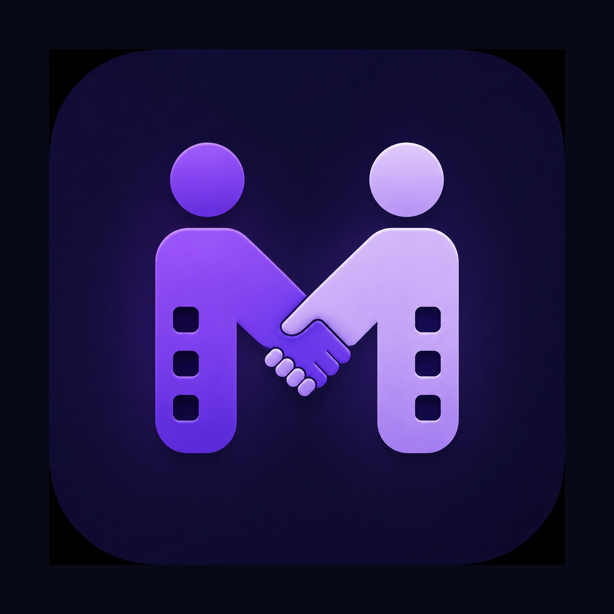
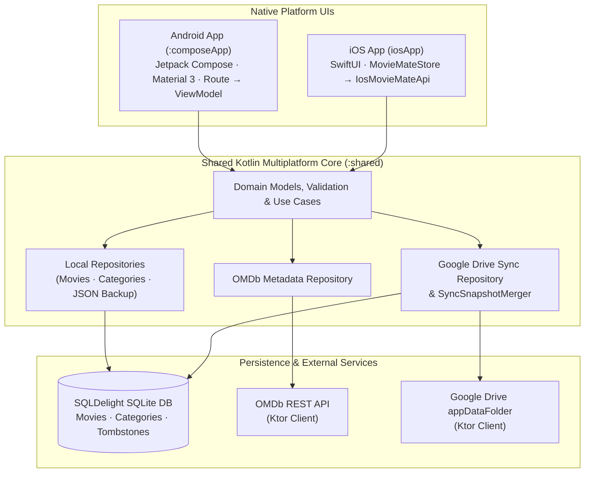

<div align="center">
  

  <h1>MovieMate</h1>

  <p>
    <strong>Cross-platform personal movie library &amp; watchlist built with Kotlin Multiplatform, Jetpack Compose, and SwiftUI.</strong>
  </p>

  <p>
    
    
    
    
    
    
    <a href="LICENSE"></a>
  </p>
</div>

---

## Overview

**MovieMate** is an offline-first movie library and watchlist manager for **Android** and **iOS**. Both native clients share a single **Kotlin Multiplatform (`shared`)** core that owns domain models, validation rules, use cases, SQLDelight local persistence, OMDb metadata lookup, portable JSON backups, and multi-device Google Drive synchronization.

Rather than sharing UI widgets across platforms, MovieMate delivers native platform experiences—**Jetpack Compose** on Android and **SwiftUI** on iOS—backed by a unified, unit-tested business and data layer.

---

## Key Features

- **Library & Watchlist Management**: Browse movies across `All`, `Watched`, and `Watchlist` tabs; search by title or description; filter by category; sort by `Recently updated`, `Title`, `Newest year`, `Best rating`, or `Runtime`; and remove entries via long-press wiggle delete mode with confirmation dialogs.
- **OMDb Metadata Lookup & Match Picker**: Search the OMDb catalog by title (and optional release year) to review matching candidates in a disambiguation dialog, then fetch full plot summaries, runtime, IMDb rating, genre mapping, and poster artwork by IMDb ID.
- **Custom Categories & Vector Icon Catalog**: Create and organize custom categories with bundled genre icons (Material Symbols vector drawables on Android and SF Symbols on iOS). Deleting a category keeps its movies intact and safely clears the category reference.
- **Rich Movie Details & Portable Posters**: Store personal ratings (1–10) alongside IMDb scores, personal notes/comments, manual streaming/watch provider chips, and custom poster images encoded as compressed JPEG Base64 data URIs (including automatic migration of legacy Android `content://` poster URIs).
- **Offline-First SQLite Persistence**: Powered by SQLDelight with versioned schema migrations (`1.sqm`), monotonic mutation timestamps, and deletion tombstones so every action works offline.
- **Multi-Device Google Drive Sync**: Privately synchronizes libraries across Android and iOS devices through Google Drive's hidden `appDataFolder` using per-device snapshots (`moviemate-sync-v1-<deviceId>.json`), canonical Drive `permissionId` account binding, deterministic conflict resolution (`SyncSnapshotMerger`), debounced sync on local changes, and periodic foreground refreshes.
- **Portable JSON Backup & Restore**: Export your full library and categories to JSON and restore via ID-based upsert on any client without requiring a cloud account.

---

## Architecture

MovieMate separates native UI layers from a shared KMP business, storage, and synchronization core:



### Module Overview

| Module | Platform / Tech | Responsibility |
| --- | --- | --- |
| `composeApp` | Android (Jetpack Compose) | Native Android UI, Navigation, ViewModels, image compression, and Google Sign-In/Authorization handler |
| `iosApp` | iOS (SwiftUI, iOS 17+) | Native SwiftUI UI, `MovieMateStore`, `GoogleSignIn` integration, embedding `Shared.framework` |
| `shared` | KMP (Android, iOS, JVM) | Domain models, validation, use cases, SQLDelight database, Ktor OMDb & Google Drive clients, `SyncSnapshotMerger` |
| `server` | JVM (Ktor Netty) | Minimal Ktor server scaffold (`Application.kt` + test setup) |

### Android UDF Pattern & Sync Merge Rules

- **Android Presentation (UDF)**: Every major feature follows `Route -> ViewModel -> UseCase`, with stateless Compose screens consuming immutable `StateFlow` UI state and emitting actions while one-shot navigation and picker events flow via `SharedFlow` effects. See [`docs/global-ui-guide.md`](docs/global-ui-guide.md), [`docs/homescreen-ui-guide.md`](docs/homescreen-ui-guide.md), and [`docs/categories-ui-guide.md`](docs/categories-ui-guide.md).
- **Multi-Device Conflict Resolution**: `SyncSnapshotMerger` merges all device snapshots in `appDataFolder` deterministically per entity ID—selecting the highest `updatedAtEpochMillis`, breaking ties by `version`, and falling back to canonical JSON comparison. Deletion tombstones win on equal timestamps, and orphaned movie `categoryId` references are cleared atomically when a category is deleted.

---

## Tech Stack

| Layer | Technology | Version |
| --- | --- | --- |
| Language & Multiplatform | Kotlin / Kotlin Multiplatform | `2.3.21` |
| Android Build | Android Gradle Plugin (Compile/Target SDK 36, Min SDK 24) | `9.0.1` |
| Android UI | Jetpack Compose BOM, Material 3, Navigation Compose | `2026.04.01` / `2.9.8` |
| iOS UI | SwiftUI (iOS 17+), Xcode | `16.2+` |
| Local Database | SQLDelight (Android, Native, SQLite JVM drivers) | `2.3.2` |
| Networking & Serialization | Ktor Client (`OkHttp`, `Darwin`, `Mock`) & Kotlinx Serialization | `3.4.3` / `1.11.0` |
| Concurrency | Kotlinx Coroutines | `1.11.0` |
| Auth & Cloud Sync | Google Play Services Auth (`21.6.0`), `GoogleSignIn-iOS` (`9.0.0`) | Drive `appDataFolder` |
| Server Scaffold | Ktor Server Netty & Logback | `3.4.3` / `1.5.32` |

---

## Project Structure

```text
MovieMate/
├── composeApp/                     # Android Jetpack Compose application
│   └── src/main/kotlin/.../
│       ├── MainActivity.kt         # Startup sequence & opening screen host
│       └── presentation/           # Routes, ViewModels, stateless Screens, theme, previews
├── iosApp/                         # Native SwiftUI iOS client
│   ├── Configuration/              # Config.xcconfig & config.local.xcconfig.example
│   ├── iosApp/                     # SwiftUI views, MovieMateStore, GoogleDriveAuthService
│   └── iosApp.xcodeproj/           # Xcode project invoking Gradle for Shared.framework
├── shared/                         # Kotlin Multiplatform shared module
│   └── src/
│       ├── commonMain/             # Domain, UseCases, SQLDelight schemas, Ktor datasources, Sync
│       ├── androidMain/            # Android SQLite driver & OkHttp AppContainer factory
│       ├── iosMain/                # Native SQLite driver, Darwin factory & Swift bridge API
│       ├── commonTest/             # UseCase, OMDb, Google Drive & SyncSnapshotMerger tests
│       └── jvmTest/                # SQLDelight SQLite sync persistence tests
├── server/                         # Ktor JVM server scaffold
├── docs/                           # Android UI architecture guides
├── gradle/libs.versions.toml       # Centralized Gradle version catalog
├── local.properties.example        # Template for local OMDb key & Android SDK path
└── LICENSE                         # MIT License
```

---

## Getting Started

### Prerequisites

- **JDK 17+** (Gradle Daemon uses Java 21 toolchain resolution via Foojay)
- **Android Studio** with **Android SDK 36** (`minSdk 24`)
- **Xcode 16.2+** on macOS (only required to build/run `iosApp`)
- A free **OMDb API key** from [omdbapi.com](https://www.omdbapi.com/apikey.aspx)

### 1. Local Configuration

Copy `local.properties.example` to `local.properties` (gitignored) in the repository root and set your OMDb API key and Android SDK path:

```properties
OMDB_API_KEY=your_api_key
sdk.dir=C:/Users/your-user/AppData/Local/Android/Sdk
```

Alternatively, supply `OMDB_API_KEY` via an environment variable during Gradle builds. `shared/build.gradle.kts` generates `Secrets.kt` at build time and fails fast if the key is missing.

### 2. Google Drive Sync Setup (Optional)

The app works completely offline without Google Cloud credentials. To enable cross-device sync via Google Drive's private `appDataFolder`:

1. Create or select a project in the [Google Cloud Console](https://console.cloud.google.com/), enable the **Google Drive API**, and configure the OAuth consent screen with the `https://www.googleapis.com/auth/drive.appdata` scope.
2. Create an **Android** OAuth client for package `de.fh.erfurt.moviemate` using the SHA-1 fingerprint of your signing keystore.
3. For iOS, create an **iOS** OAuth client for bundle ID `de.fh.erfurt.moviemate` in the same Google Cloud project, copy [`iosApp/Configuration/config.local.xcconfig.example`](iosApp/Configuration/config.local.xcconfig.example) to `iosApp/Configuration/config.local.xcconfig` (gitignored), and add your `TEAM_ID` and client values. See [`iosApp/README.md`](iosApp/README.md) for full macOS/Xcode instructions.

### 3. Build & Run

**Windows (PowerShell):**

```powershell
.\gradlew.bat :composeApp:assembleDebug
```

**macOS / Linux:**

```shell
./gradlew :composeApp:assembleDebug
```

**iOS (macOS):**

Open `iosApp/iosApp.xcodeproj` in Xcode 16.2+, wait for Swift Package Manager to resolve `GoogleSignIn`, select your team (or configure `config.local.xcconfig`), and run the `iosApp` scheme on iOS 17+.

**Ktor Server Scaffold:**

```shell
./gradlew :server:run
```

---

## Testing

The project includes unit and integration tests covering domain use cases & validation, ViewModel state/effect transitions, Ktor OMDb and Google Drive data sources (via `MockEngine`), SQLDelight sync persistence, and deterministic `SyncSnapshotMerger` conflict/tombstone resolution:

```shell
# Shared KMP tests (commonTest, Android unit tests, JVM SQLDelight tests)
./gradlew :shared:allTests

# Android Presentation ViewModel tests
./gradlew :composeApp:testDebugUnitTest

# Ktor Server scaffold tests
./gradlew :server:test
```

*(On Windows, use `.\gradlew.bat`.)*

---

## License

This project is licensed under the MIT License — see the [LICENSE](LICENSE) file for details.
